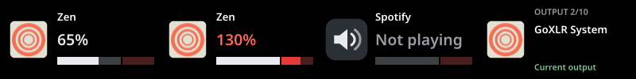

# App Volume

An [OpenDeck](https://github.com/nekename/OpenDeck) plugin (OpenAction API) that turns each
Stream Deck+ dial into a per-application volume mixer.



> **Alpha.** Tested on Linux (OpenDeck Flatpak, PipeWire, KDE Plasma) with a Stream Deck+.
> Expect rough edges.

## Installation

Download `AppVolume-<version>.zip` from the
[releases](https://github.com/MrBretze/AppVolume/releases), then in OpenDeck use Plugins →
"Install from file", and restart OpenDeck. On Linux with the OpenDeck Flatpak, also grant
audio access (see [below](#linux-opendeck-flatpak-permissions)).

The zip contains executables for Linux x86_64, Linux ARM64, Windows x86_64 and macOS (one
universal executable). OpenDeck picks the right one.

| Platform | Status |
| --- | --- |
| Linux x86_64 | Tested with OpenDeck (Flatpak) on KDE Plasma, PipeWire |
| Linux ARM64 | Built and unit-tested automatically, not tried on a real machine |
| Windows 10 / 11 | Built and unit-tested automatically, not tried yet |
| macOS | Builds, but per-application volume is not supported (see below) |

## Usage

Drag the **App volume** action onto a dial. Each dial controls one application.

**Volume mode** (default)

| Input | Effect |
| --- | --- |
| Turn | Volume ±5 % (±1 % while the dial is held down) |
| Click | Next application that is playing audio |
| Hold (0.5 s) | Enter output mode |

The LCD shows the app icon, its name, the volume and a bar. On Linux the volume goes up to
150 %; the part above 100 % is drawn in red. A dial keeps its app across restarts: if the app
is not playing, the dial shows "Not playing" until it plays again.

**Output mode**

| Input | Effect |
| --- | --- |
| Turn | Browse output devices (nothing changes yet) |
| Click | Move the app to the shown output, back to volume mode |
| Hold (0.5 s) | Cancel, back to volume mode |

Output mode closes by itself after 30 s without input (each dial turn restarts the countdown).

## Settings

Click a dial in OpenDeck to open its settings.

- **This dial**: the application it controls (or automatic, by position), and what a click
  does: next application, or mute / unmute.
- **All dials**: volume step, fine step (dial held down), maximum volume (Linux, up to
  150 %), long-press duration, output-mode timeout, screen language (automatic, English,
  French) and debug logs.

## Application names

Some apps report an unclear name to the audio server (Discord: "WEBRTC VoiceEngine", KDE:
"plasmashell"). `app-names.json` in the plugin folder maps them to the name to show:

```json
"names": {
	"WEBRTC VoiceEngine": "Discord",
	"plasmashell": "@system",
	"gsd-*": "@system"
}
```

- The left side is compared, ignoring case, with the Flatpak app id, then the executable,
  then the stream's application name. A trailing `*` matches a prefix.
- `@system` groups the app with the desktop's own sounds under **System**.
- The file is reloaded a few seconds after it is saved. Run the binary with `--list` to see
  the names each app reports (`reports [...]`).
- `scripts/install.sh` replaces the installed copy: make lasting changes in
  `assets/app-names.json`.

## Languages

The LCD follows OpenDeck's language (English or French), falling back to `LANG`.
Translations are in `assets/lang/<language>.json` (Stream Deck SDK format: manifest strings
plus a `Localization` section for the LCD). Keep LCD strings short: the volume line fits
about 11 characters.

## Platform support

| Platform | Volume | Output routing | Notes |
| --- | --- | --- | --- |
| Linux | ✅ | ✅ | PipeWire (via `pipewire-pulse`) or PulseAudio. Up to 150 %. |
| Windows 10/11 | ✅ | ✅ | WASAPI sessions. Output routing uses the same undocumented API as Windows' *App volume and device preferences* page. Max 100 %. |
| macOS | ❌ | ❌ | macOS has no public API for another app's volume. The dial shows "Not supported". |

## Linux: OpenDeck Flatpak permissions

The OpenDeck Flatpak has no access to the audio server by default, so the dial shows
**"No audio access"**. Grant it once, then restart OpenDeck:

```sh
flatpak override --user --socket=pulseaudio me.amankhanna.opendeck
```

Optional: if you installed an icon theme in your home folder (e.g. Papirus in
`~/.local/share/icons`) and want the dials to use it:

```sh
flatpak override --user --filesystem=xdg-data/icons:ro me.amankhanna.opendeck
```

System icons and icons of Flatpak apps work without this.

## Building

Requires a stable Rust toolchain.

```sh
cargo build                 # debug build
cargo test                  # unit tests
scripts/install.sh          # release build, installed into OpenDeck's plugin folder
```

`scripts/install.sh` builds a static musl binary on Linux (the Flatpak runtime may have an
older glibc than the host) and copies `assets/` plus the binary to
`~/.var/app/me.amankhanna.opendeck/config/opendeck/plugins/com.mrbretzel.appvolume.sdPlugin`
(or `~/.config/opendeck/plugins/…` for a native OpenDeck). Restart OpenDeck afterwards.

`.github/workflows/release.yml` tests and builds every platform on each push. Pushing a
`v*` tag that matches `Version` in `assets/manifest.json` attaches `AppVolume-<version>.zip`
to the GitHub release of that tag.

## Troubleshooting

Run the plugin binary with `--list` to print the applications, volumes, outputs and icon
lookups it sees. To check from inside the OpenDeck sandbox:

```sh
flatpak run --command=$HOME/.var/app/me.amankhanna.opendeck/config/opendeck/plugins/com.mrbretzel.appvolume.sdPlugin/appvolume-x86_64-unknown-linux-gnu me.amankhanna.opendeck --list
```

OpenDeck writes the plugin's log to `plugin.log` in the plugin folder.

## License

[CeCILL 2.1](LICENSE).
